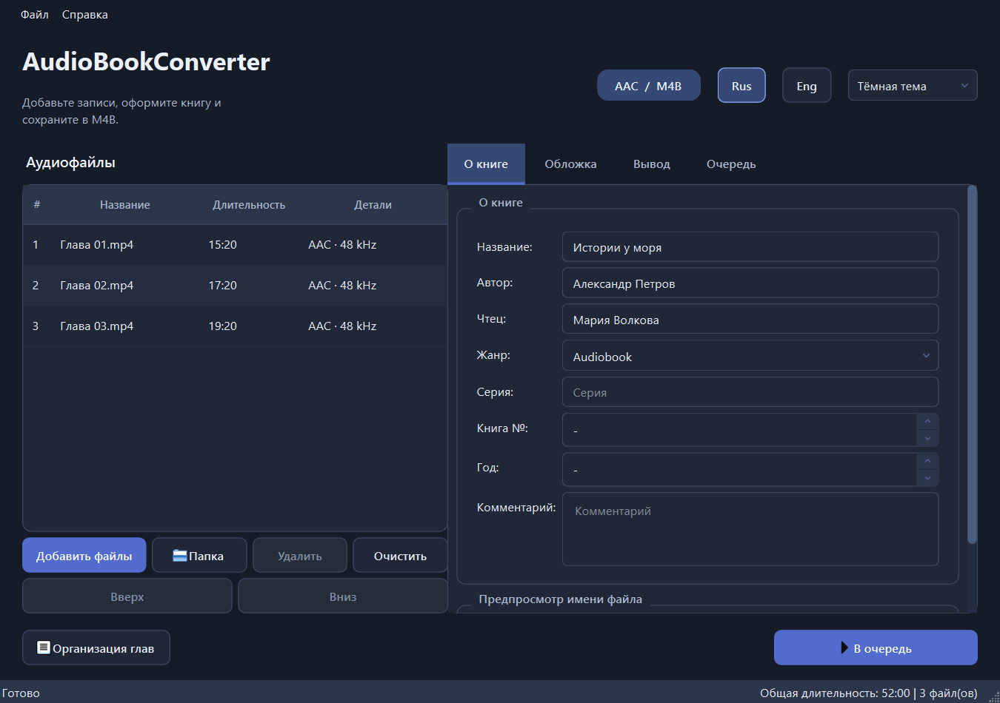
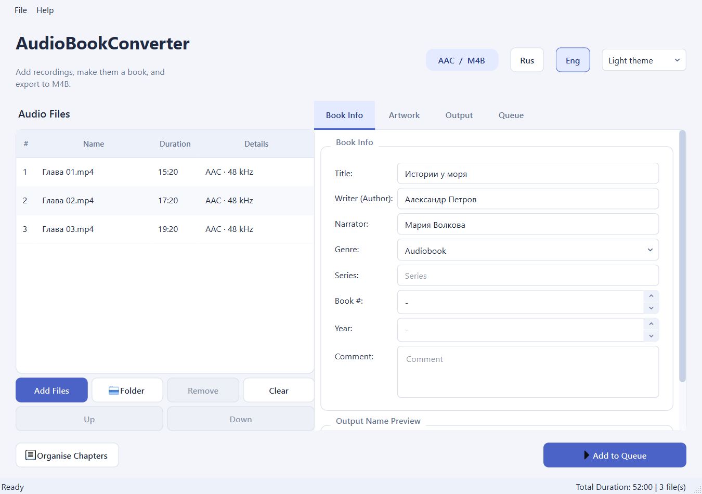

# AudioBookConverter 1.1.0

Приложение для Windows, которое объединяет аудиофайлы и звуковые дорожки MP4
в аудиокниги M4B с главами, метаданными и обложкой.

A Windows desktop app for creating M4B audiobooks from audio files and MP4 videos.
Built with Python, PySide6 and FFmpeg. Russian and English interface, light and dark themes.

## Возможности

- Импорт MP3, WMA, M4A, FLAC, WAV, AAC, OGG, M4B и MP4, включая смешанные форматы.
- Для MP4 используется основная звуковая дорожка (`default`), иначе первая; видео игнорируется.
- Добавление файлов и папок, перетаскивание и изменение порядка записей.
- Главы из имён файлов, ручное переименование, объединение и разделение глав.
- Название, автор, чтец, серия, жанр, год, комментарий и обложка книги.
- Одна книга, разделение по частям или по заданной длительности.
- Очередь заданий, прогресс, пауза, продолжение и отмена.
- Сохранение и загрузка проектов `.abcproj`.
- Переключение **Rus / Eng** и **светлой / тёмной темы** без перезапуска.

Существующие выходные файлы не перезаписываются: новые получают суффиксы `(2)`, `(3)`.
При отмене удаляется незавершённая часть; готовые части сохраняются.

## Интерфейс



<details>
<summary>Светлая тема и английский интерфейс</summary>



</details>

## Скачать для Windows

[**Скачать AudioBookConverter 1.1.0 — Windows x64 (ZIP)**](https://github.com/EvgenBell/audiobookconverter/releases/download/v1.1.0/AudioBookConverter-1.1.0-windows-x64.zip)

1. Распакуйте **весь архив** в отдельную папку.
2. Запустите `AudioBookConverter.exe` из папки `AudioBookConverter`.

Python и FFmpeg уже включены; устанавливать их отдельно не нужно.
Не переносите EXE отдельно от папки `_internal`. Требуется Windows 10/11 x64.
Описание версии и контрольная сумма — на [странице релиза 1.1.0](https://github.com/EvgenBell/audiobookconverter/releases/tag/v1.1.0).

## Запуск из исходников

Нужны Windows 10/11, Python 3.11+ и FFmpeg вместе с FFprobe.
Проверено на Windows, Python 3.11.9, PySide6 6.10.2 и FFmpeg 8.0.1.

1. Скачайте исходники через **Code → Download ZIP** или клонируйте репозиторий.
2. Скачайте [FFmpeg для Windows](https://ffmpeg.org/download.html#build-windows).
   Поместите `ffmpeg.exe` и `ffprobe.exe` в папку `bin` проекта или добавьте их папку в `PATH`.
3. Откройте PowerShell в папке проекта и выполните:

```powershell
py -3.11 -m venv venv
.\venv\Scripts\python.exe -m pip install -r requirements.txt
.\venv\Scripts\python.exe -m src.app
```

Если Python установлен без команды `py`, используйте `python -m venv venv`.
Путь к FFmpeg также можно указать в настройках приложения.

## Как создать аудиокнигу

1. Добавьте аудиофайлы или видео MP4 и расположите их в нужном порядке.
2. Заполните вкладку **О книге**, при необходимости выберите обложку.
3. Во вкладке **Вывод** выберите папку, битрейт и режим разделения.
4. Кнопкой **Организация глав** проверьте названия и границы глав.
5. Нажмите **В очередь**, затем **Запустить** на вкладке очереди.

Шаблон имени выходного файла поддерживает `{Writer}`, `{Title}`, `{Narrator}`,
`{Series}`, `{Book}`, `{Year}`, `{Genre}` и `{Part}`.

Настройки и журнал находятся в `%APPDATA%\AudioBookConverter`.
Проект хранит пути к исходным файлам; сами аудиофайлы в `.abcproj` не копируются.

## Проверки

```powershell
.\venv\Scripts\python.exe -m src.app --check
.\venv\Scripts\python.exe -m unittest discover -s tests -v
```

Тесты используют стандартный `unittest`, Qt и FFmpeg. Они создают короткие тестовые
записи во временной папке. Проверяются смешанные форматы и дорожки MP4, порядок звука,
главы, метаданные, обложки, отмена, очередь, сохранение проектов, язык и темы.

## Сборка для Windows

Перед сборкой положите `ffmpeg.exe` и `ffprobe.exe` в `bin` проекта.

```powershell
.\venv\Scripts\python.exe -m pip install pyinstaller
.\venv\Scripts\python.exe -m PyInstaller --noconfirm --distpath dist\updated --workpath build\updated AudioBookConverter.spec
```

Результат: `dist\updated\AudioBookConverter\AudioBookConverter.exe`.
Для переноса нужна **вся папка** `AudioBookConverter`, включая `_internal`.

В Git хранятся исходники. Окружение Python, FFmpeg, папки сборки, пользовательские
аудиофайлы и локальные журналы исключены через `.gitignore`.

## Версия 1.1.0

Поддержка основной дорожки MP4, мгновенное переключение Rus/Eng, светлая и тёмная
темы, упрощённое окно «О программе». Исправлены склейка смешанных форматов,
разделение по времени, отмена и упаковка Qt для Windows.

## Лицензия

Исходный код приложения — [MIT](LICENSE), как указано в метаданных проекта.
Сторонние компоненты распространяются по собственным лицензиям:
[FFmpeg](https://ffmpeg.org/legal.html), [PySide6 / Qt](https://doc.qt.io/qtforpython-6/licenses.html),
[Mutagen](https://mutagen.readthedocs.io/), [Pillow](https://python-pillow.org/).
Состав готовой Windows-сборки, лицензии и ссылки на исходники компонентов:
[THIRD-PARTY-NOTICES.txt](THIRD-PARTY-NOTICES.txt).

Разработчик: Евгений Белявский · [Telegram](https://t.me/evgen_rus).
